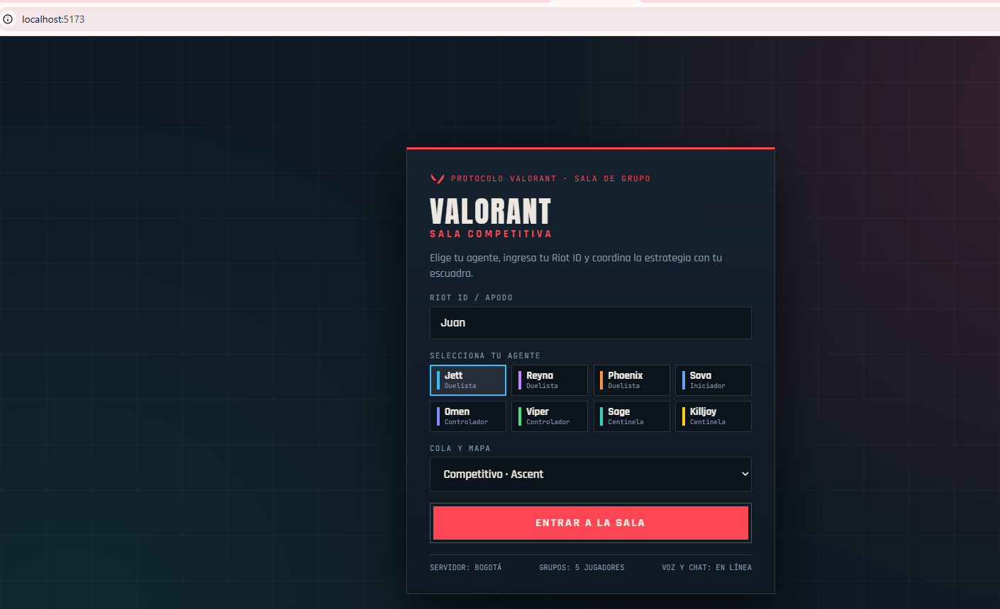
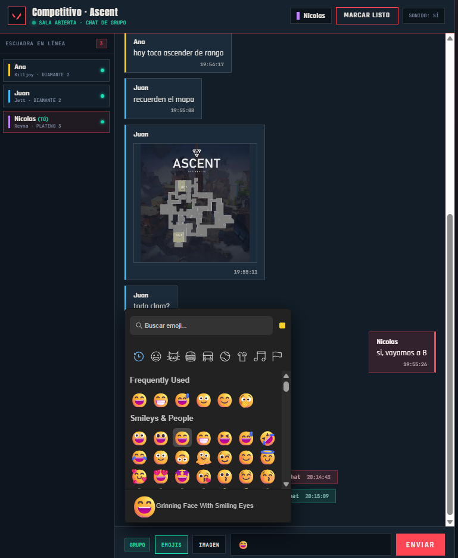
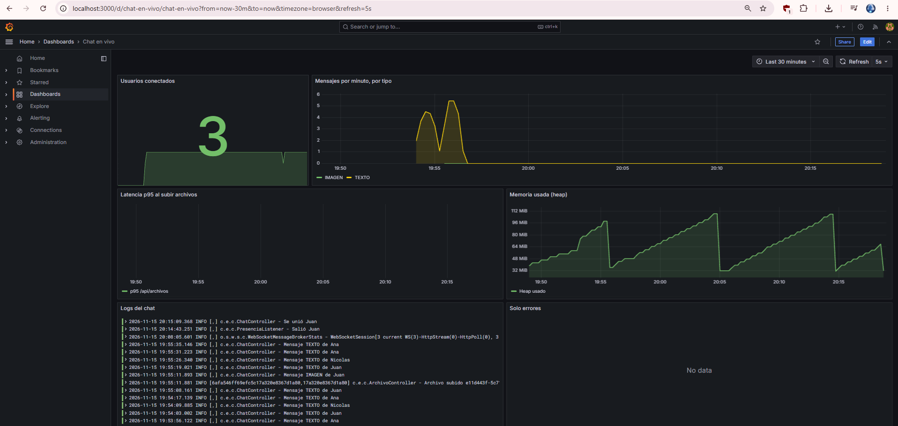

# chat-client

Cliente web en **React + Vite** para el chat en tiempo real sobre **WebSocket y STOMP** (`@stomp/stompjs`), tematizado como sala de grupo de **Valorant**.

## Qué hace y cómo se conecta con `chat-server`

- Se conecta por WebSocket al servidor Spring Boot ([chat-server](../chat-server)) en `ws://localhost:8080/ws` con reconexión automática (`reconnectDelay: 3000`).
- Envía y recibe mensajes en tiempo real usando STOMP.
- Consume la API HTTP del servidor en `http://localhost:8080` para subir imágenes (`POST /api/archivos`) y consultar conectados (`GET /api/usuarios`).

## Cómo correrlo en local

**Requisitos:** Node.js 20 o superior y tener `chat-server` corriendo en `http://localhost:8080`.

1. Instala las dependencias:
   ```bash
   npm install
   ```
2. Inicia el servidor de desarrollo:
   ```bash
   npm run dev
   ```
3. Abre `http://localhost:5173` en dos o más pestañas del navegador con distintos nombres.

## Destinos STOMP

| Acción | Destino | Uso en el cliente |
| :--- | :--- | :--- |
| Publicar (`publish`) | `/app/chat.unirse` | Envía el apodo y el agente elegido al conectarse. |
| Publicar (`publish`) | `/app/chat.enviar` | Envía mensajes de texto (`TEXTO`) o URLs de imágenes (`IMAGEN`). |
| Suscribirse (`subscribe`) | `/topic/sala` | Recibe los mensajes del grupo y notificaciones de entrada/salida. |
| Suscribirse (`subscribe`) | `/topic/usuarios` | Actualiza en vivo el panel lateral de jugadores conectados. |

## Tema escogido y funciones extra

- **Tema:** **Lobby Gamer de Valorant (Sala de Grupo)** completamente en español. Incluye paleta oficial (`#0F1923`, `#FF4655`, `#ECE8E1`, `#18E0B4`), selección de **Agente** (`Jett`, `Reyna`, `Phoenix`, `Sova`, `Omen`, `Viper`, `Sage`, `Killjoy`), cola/mapa, rangos, botón de estado **`MARCAR LISTO` / `LISTO`** y sonidos tácticos al entrar, salir o recibir mensajes.
- **Funciones extra implementadas:**
  1. **Emojis:** selector desplegable oscuro con `emoji-picker-react`.
  2. **Imágenes:** carga de archivos por HTTP (`POST /api/archivos`) y previsualización dentro del chat.
  3. **Quién está conectado:** panel lateral **ESCUADRA EN LÍNEA** mostrando cada jugador con su agente y rango en tiempo real.

**Pantalla inicial con selector de agente y mapa de Valorant:**  


**Sala de grupo con conectados en línea y selector de emojis:**  


## Observabilidad del proyecto

La observabilidad corre desde la carpeta `observabilidad/` del repositorio `chat-server` (Prometheus, Loki, Zipkin y Grafana):

```bash
cd ../chat-server/observabilidad
docker compose up -d
```

Luego accede a Grafana en `http://localhost:3000` e importa `chat-server/observabilidad/dashboard-chat.json`.

**Tablero `Chat en vivo` en Grafana con métricas del chat y logs:**  

